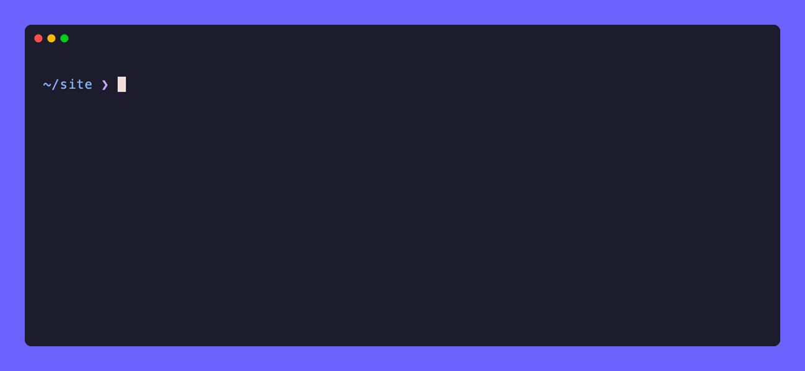

# aix

Describe what you want, get the shell command, run it with one key. Runs on Apple Intelligence, on your Mac.



```sh
brew install jaiamin/aix/aix
```

Needs Apple silicon, macOS 26+ and Apple Intelligence.

- `aix <request>`, or `aix` alone to type it without quoting. Questions like `aix what does chmod 755 mean` get a short answer.
- `aix explain <command>` breaks a command down. `aix fix` fixes your last failed command.
- Add `eval "$(aix init zsh)"` to `~/.zshrc` for the shell integration: type a request at your prompt and press **Ctrl-G** to turn it into the command, press `e` at the Run prompt to edit a command on your prompt line, and find commands aix ran in your history. `aix fix` needs it too.

The model is small, so read the command before pressing `y`. aix learns from commands you approve; they're kept in `~/Library/Application Support/aix/history.json`.

To improve it, add examples to [`Examples.swift`](Sources/AixCore/Examples.swift) and run `make test`. MIT License.
